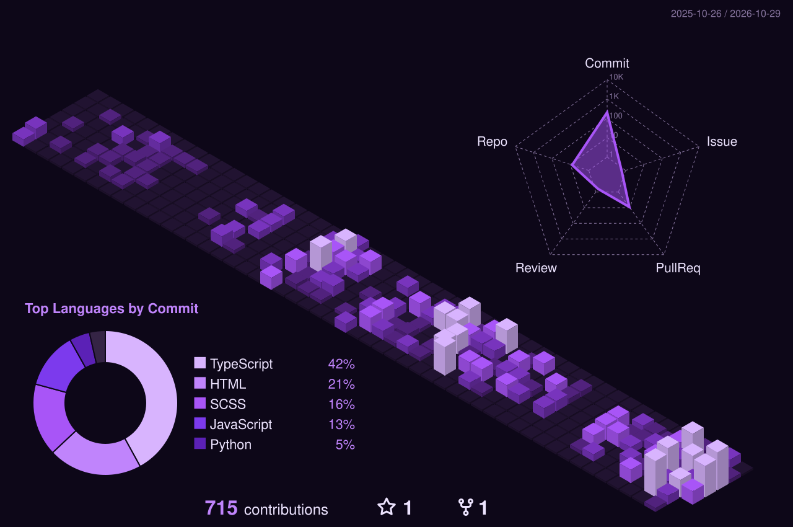

<!-- Animated Header -->

  

<!-- Typing Animation -->

  

<!-- Profile Views -->

  

<!-- Developer Terminal -->
<h2 align="center">⚡ Developer Terminal</h2>

    $ whoami
    > ansalim01

    $ cat skills.txt
    > TypeScript | JavaScript | Vue | React | Node.js

    $ echo $MISSION
    > Building clean ideas with code

    $ git status
    > Always improving...

<!-- GitHub Analytics -->
<h2 align="center">📈 GitHub Analytics</h2>

<!-- Top Three Charts -->

  
  
  

<!-- 3D Contribution Graph -->

  

<!-- Connect -->
<h2 align="center">🌐 Connect With Me</h2>

  
  

<!-- Footer -->

  

